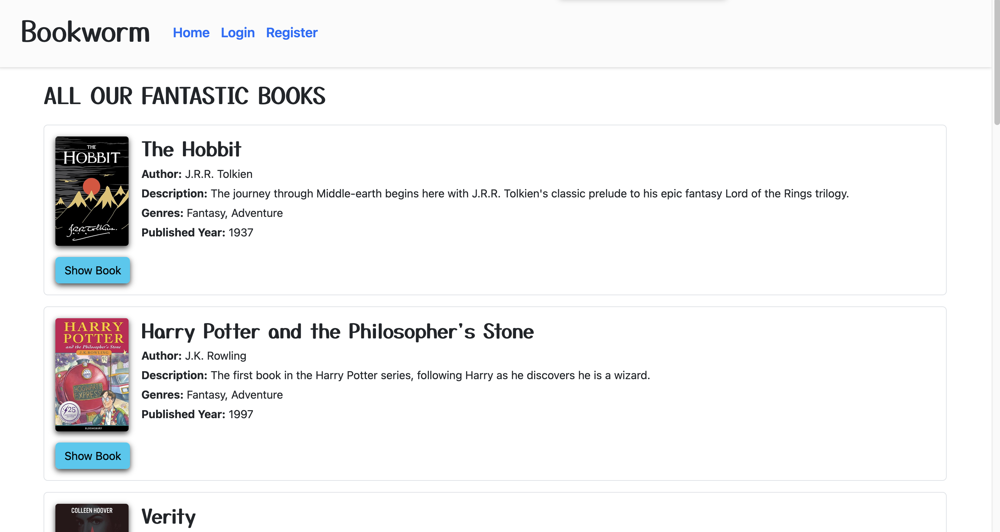
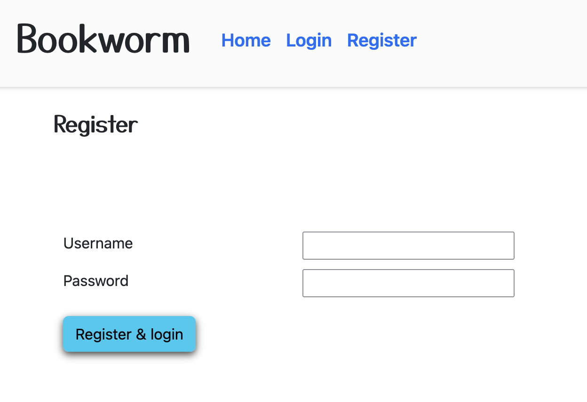
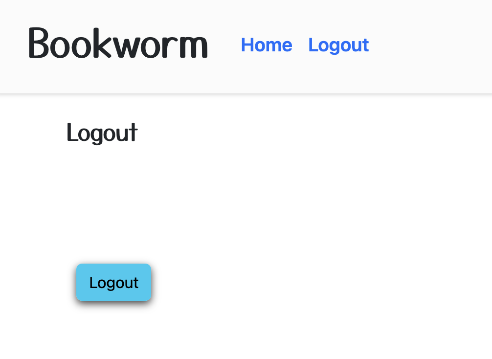
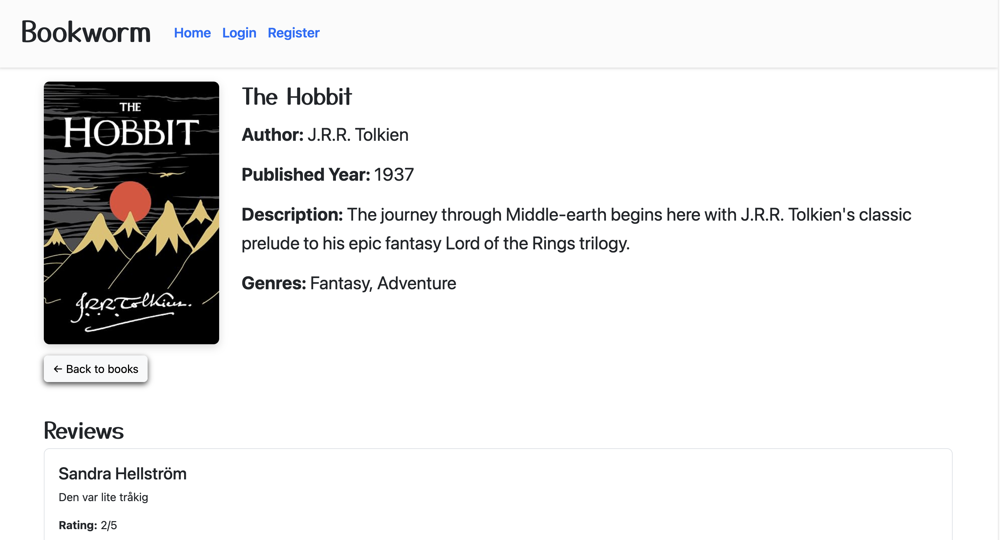
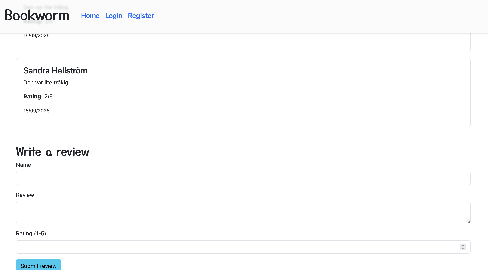
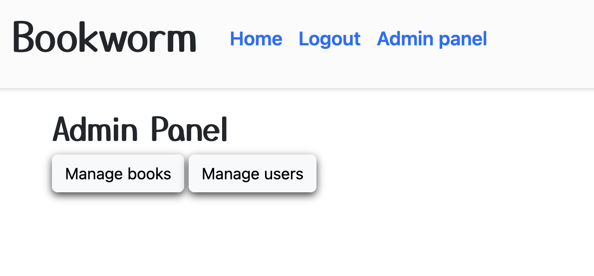
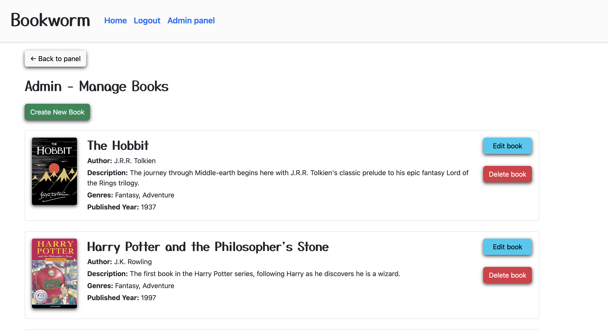
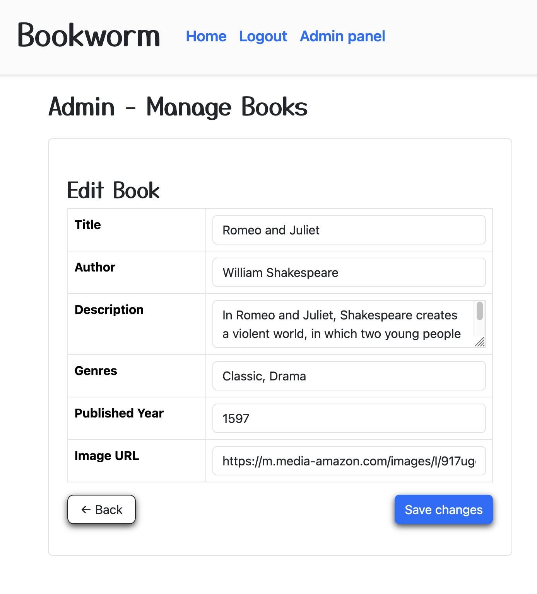
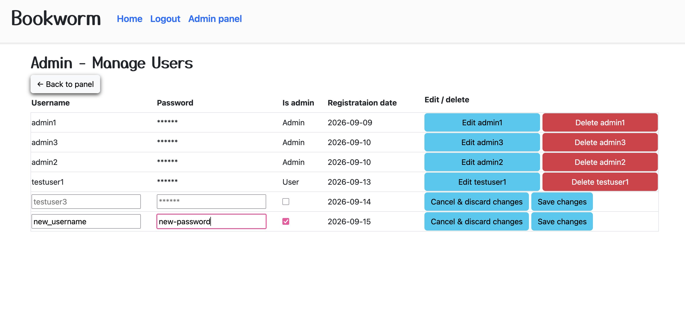
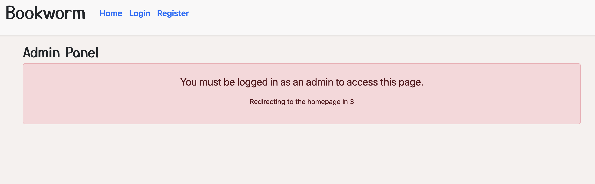

# Bookworm
Live link: https://api-assignment-2-eta.vercel.app

Table of contents
- [About](#about)
- [Developers](#developers)
- [Preview](#preview)
- [Technologies](#technologies)
- [Testdata](#testdata)
- [Technical Details](#technical-details)

## About
Bookworm is a directory of books, where visitors can browse books and read reviews. Any visitor can write their own reviews for other visitors to see. Bookworm also has an admin feature, where users with admin priviledges can create, edit and delete books and users. Non-admins cannot access the admin panels, as they're hidden. If the user somehow find themselves in an admin panel, the page will block content and redirect them back to the landing page after a countdown.

## Developers
- Helena Gustafsson
- Sandra Hellström
- Alma Isaksson

## Preview
Landing page

Register page

Logout page

Book detail

Book detail write review

Admin panel

Admin books manager

Admin books manager edit mode

Admin users manager

Admin user is not admin

## Technologies
- TypeScript & Node
- Express
- Mongoose
- MongoDB
- HTML, JavaScript, CSS
- Github
- Vercel

## Testdata
Note: Test mock data can be found inside the MongoDB-json directory

## Technical Details

### Admin Authentication & Access Control

The admin book manager is protected by authentication and role‑based access.
Only logged‑in admin users can view, create, edit or delete books.
Non‑admins are blocked from the page, shown a clear error message, and automatically redirected after a short countdown to main page (index.html).

### Book Management (CRUD)
Admin users can manage books through a fully dynamic interface:

#### Create:

- All fields validated (title, author, description, genres, year, image)
- Inputs trimmed and normalized.
- Genres converted into a clean array.
- Published year validated as a number.
- Success message displayed, followed by a timed redirect back to the admin panel showing books.

#### Edit:

- All fields pre‑filled with backend data.
- Changes saved via a PATCH request
- Success message shown before returning to the admin panel with timer.

#### Delete:

- Delete actions require confirmation through a visible confirmation box.
- Smooth scroll ensures the box is visible.
- Success message displayed, followed by a timed reload of the book list.

#### Dynamic Rendering & UI Behavior
The admin interface is rendered dynamically with JavaScript:

- Book lists and forms generated using .map().join("").
- Dynamic button visibility: admin‑specific buttons such as Back to Panel and Create New Book are shown or hidden depending on whether the user is viewing, creating or editing a book.
- Responsive layout adapts images, tables, buttons and message boxes to screen size.
- Consistent design across all pages/views.

#### Validation & Data Normalization
To ensure consistent data quality:

- All text fields trimmed.
- Titles and descriptions capitalized.
- Authors and genres capitalize each word.
- Genres split and cleaned into arrays.
- Published year converted to a number before saving.

#### User Feedback & Error Handling
The admin system provides clear feedback for all actions:

- Error messages for invalid input, missing fields or failed API calls.
- Error message + redirect for unauthorized users.
- Success alerts for create, update and delete operations.
- Confirmation boxes for delete actions.
- Timeouts and redirects for improved user experience.

### User management (CRUD)

#### Read all:
The user management fetch all users, then store the fetched data in a variable state, using Map "usersData", with each user's ID as the Map key. All data, besides password are retrieved.

#### Create:
User creation is done through the register form page. If the user is authenticated, they must first logout to see the link to the registration page in the GUI.

- Error messages for invalid input. Specified message and status code is provided by the backend.
- Successful registration redirects the user to the landing page, authenticated as the new user.
- New user is regular user by default.

### Edit:
Target user's data is fetched from the "usersData" Map. By default, the edit fields hold current username as placeholder, and their admin state as a checkmark. Password is left out. The backend edit existing users with PATCH, meaning only specified fields in the body are edited, whereas the unspeficied remain untouched. Admin could for instance leave new username and new password blank, but toggle user's admin state, without seeing a complain.

The editor can store multiple drafts within the same page. The "editUsersData" Map makes a copy of its equivalent user, allowing itself to be mutated, until admin either save or discards. On cancel revert back to the original "usersData" Map, on save overwrites the original "usersData" after making changes to the backend. Both save and discard drops its equivalent "edutUsersData".

- Admin can hold up to every user in edit mode, where multiple drafts are isolated. Saving or discarding changes on one user does not affect the rest of the page.
- Error messages for invalid input are displayed at the centre-top, if the field is touched at all.
- Successful editing display ok message at the centre-top, and exit edit mode for that user, with updated data.
- On cancel exit edit mode on that user, reverting back the GUI with its original state.

### Delete:
Delete behaves in a similar way as editing with its isolated DOM. The delete button cannot be accessed in edit mode. For safety, admin must confirm their intention. The actual delete button does not exist in the DOM until admin clicks a button that triggers JavaScript to append the actual delete button. The "usersData" Map also holds a state if the confirm delete DOM is open or not, preventing admin to append an infinite ammount of confirm deletion DOM:s.

- Clicking `"Delete <username>"` reveal a new DOM with confirm and cancel button.
- Clicking cancel on the confirm DOM removes the confirm deletion DOM.
- Clicking delete on the confirm DOM removes the user from the backend, then removes the entire table-row belonging to that user.